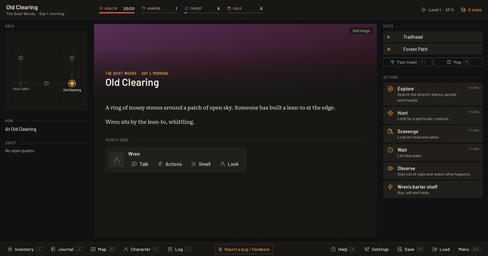
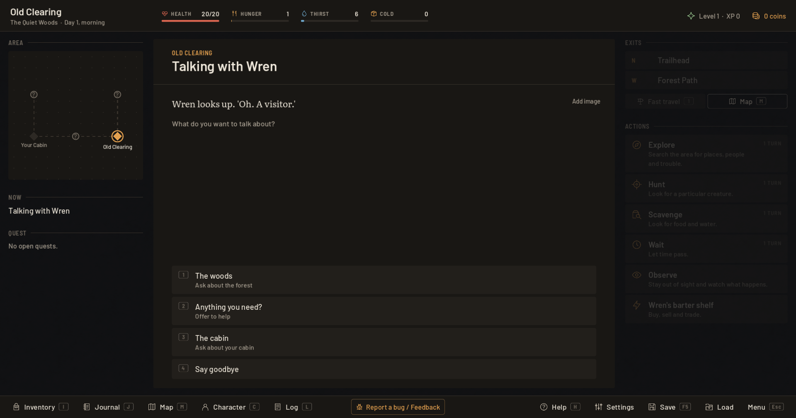
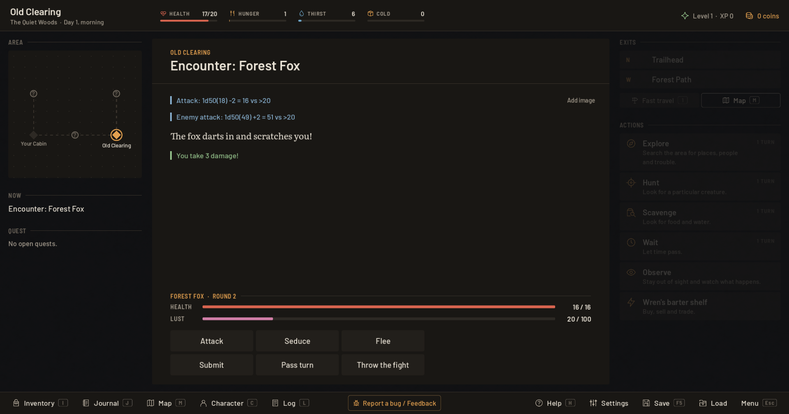
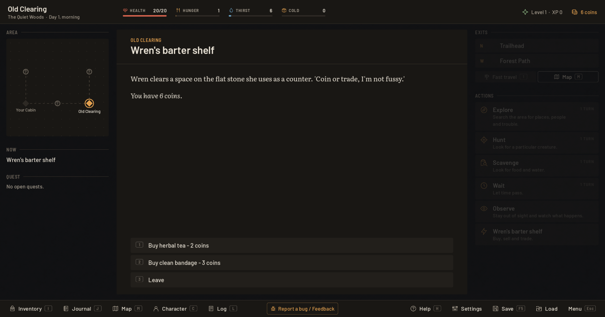
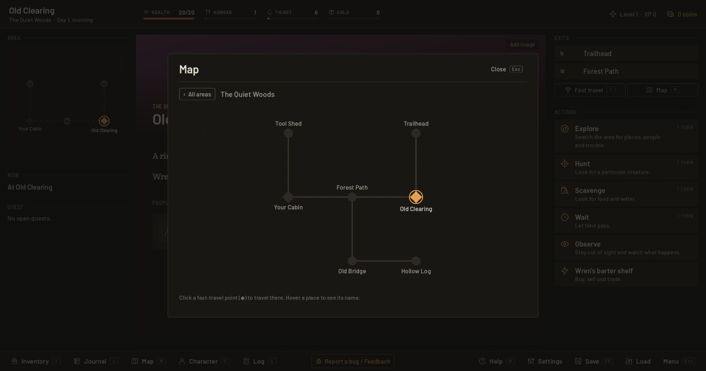
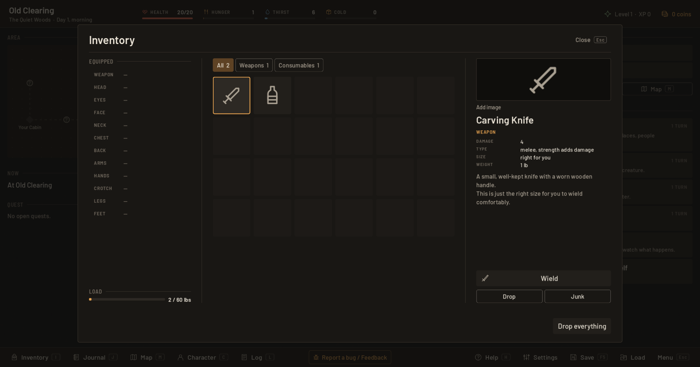
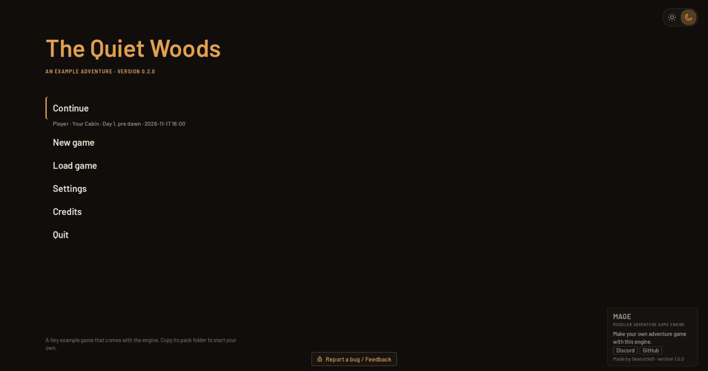
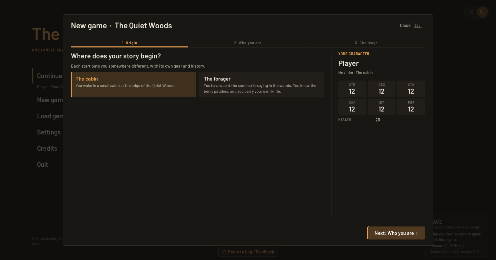
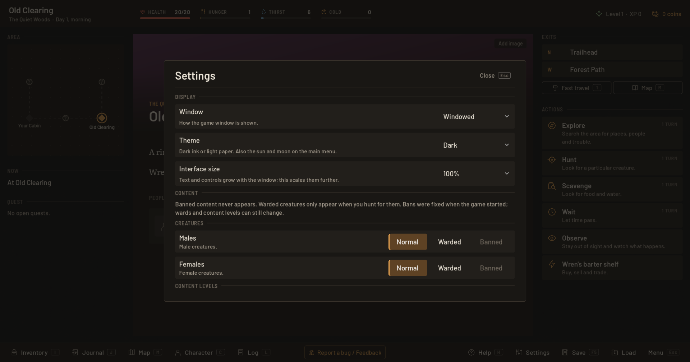
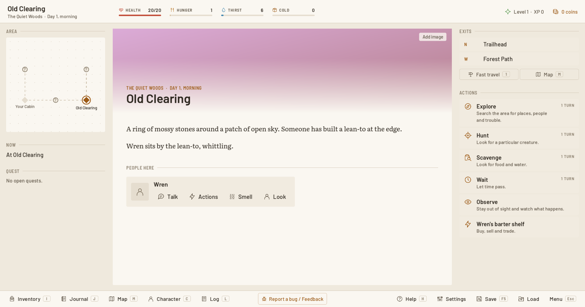

# MAGE

MAGE (Modular Adventure Game Engine) runs text-driven adventure and role-playing games. The engine knows the rules: time, travel, conversations, fights, items, saving. The game itself comes from content packs. These are folders of plain text files and images that describe the places, characters, items, events and creatures, and every line of text the player reads.



MAGE is a Godot 4.7 project written in GDScript. It runs offline on the desktop. Version 1.0.0 is its first public version; the content format and save format will still change, and the [changelog](CHANGELOG.md) says what did.

Packs can be written by hand in a text editor, or made with [MAGE:EDITOR](https://github.com/Seaturtle5/MAGE-EDITOR), which builds them from sentences, a story board and a map.

## Contents

- [What a game looks like](#what-a-game-looks-like)
- [What the engine handles](#what-the-engine-handles)
- [Content packs](#content-packs)
- [Running it](#running-it)
- [Tests](#tests)
- [Layout](#layout)
- [License](#license)

## What a game looks like

The pictures show *The Quiet Woods*, the small example game that comes with the engine. Everything in them is content of that pack: the engine brings the screens, the pack brings the words.

### The moment, not a scrolling log

The middle of the screen shows what is happening now: the place and who is there, or the scene that is playing. The ways out and the things to do stand beside it in panels of their own, each with what it costs in turns. The top bar holds the meters the game defines (here health, hunger, thirst and cold), and a small map shows where the player is.

### Conversations and choices

Scenes are prose with choices. A talk menu lists what can be said; a choice can be offered only under a condition, and it can lead to another scene, change a value or move a quest along. Every choice has a number key.



### Fights

Fights are turn-based, against the creatures the packs define, with the rolls shown. A creature brings its own attacks and texts, and a pack can add buttons, special moves and scripted stages.



### Shops

A shop buys, sells and trades at a place, when its keeper is there and it is open. Prices are in a currency the game chooses.



### The map

The map is drawn from the places and their exits; a pack does not have to draw one. Places next to the ones the player knows show as question marks, the rest stay hidden, and fast-travel points can be clicked to go there.



### Items and gear

The inventory shows what the player carries, by kind, with what each thing is and what can be done with it: use, wear, wield, drop. Worn and wielded things have their slots, and everything has a weight.



### The game's own title and start

The title, subtitle, logo, background and the line under the menu come from the game's pack, so the engine carries no branding of its own. A new game starts from one of the pack's scenarios, and the player sets up their character in a few steps.





### What the player controls

Settings hold the window, the theme and the interface size, and the content settings the game defines: kinds of content a player can ban or keep at a distance. There are a dark and a light theme.





Also there: a journal for quests and the player's own notes, a character sheet, a log of what was shown, help topics the game writes, named saves with a picture of the moment, an autosave and a quicksave, and a button that sends a bug report to an address the game sets.

## What the engine handles

- **Content packs.** Packs can be stacked: a pack can require others, and the engine loads them in the order they need. A validator checks every pack and reports each problem with its file, line and a plain explanation.
- **Scenes.** Scenes are written as prose with choices, talk menus, conditions, effects and varied text. A scene can wait for the player and continue later.
- **The world.** Regions, zones and locations with exits, a map drawn from the location data, fast travel, and things to find while exploring.
- **People and quests.** Characters have their own values, such as how much they trust the player. Quests move through named stages.
- **Time.** Actions take turns. Hunger, thirst, rest and conditions tick along with the clock, and scenes can be scheduled for later.
- **Fights.** Turn-based combat against creatures, with weapons and gear.
- **Bodies.** A character's body is made of parts, and content can change them.
- **Items.** Inventory, carry weight, equipment, and items that can be used or dropped.
- **Saves.** Named save slots with thumbnails, an autosave and a quicksave.
- **Repeatable runs.** A built-in random number generator, so the same seed always plays out the same way.
- **A Debug window for authors.** With Debug tools switched on in Settings, a Debug button on the bottom bar opens it: type a command or a line of story script (`~ give rope 2`, `~ go to great_hall`, `play bonfire`) with suggestions as you type, run the test commands your packs define (`== command` with `debug: yes`), and look up and change the game's values.

The interface shows the current moment rather than a scrolling log, with navigation and actions in separate panels. The game pack supplies the title, logo, background and about text, so the engine carries no branding of its own.

## Content packs

A pack is a folder with a `pack.fsc` manifest, content files ending in `.fsc` and an `images/` folder:

```
my-pack/
    pack.fsc
    characters/
    creatures/
    events/
    items/
    locations/
    images/
```

The manifest names the pack and what it needs:

```
== pack my-pack
name: My pack
version: 0.1.0
authors: Your name
requires: base-pack
```

The pack that is the game also sets `title`, `subtitle`, `logo`, `background` and `about`, and may set a `start notice` (shown each time the game starts), a `feedback webhook` (a Discord webhook address that the Report a bug / Feedback button sends players' short reports to) and a `feedback receiver` (an address of your own that gets the whole report as JSON, with the state of the game and a save when the player allows it).

Content files are meant to be read and written without programming. A short example from the test pack:

```
== menu mira.talk
title: What do you want to talk about?
leave: Nevermind

* The town -- Ask what happened here
    -> mira.about_town
* Supplies -- Ask if the shelter needs anything [if quest supplies is not_started]
    Mira sighs. 'Food, mostly. If you find anything sealed, bring it here.'
    ~ quest supplies = asked
```

The engine looks for packs in these places:
- the `packs/` folder inside the project
- a `packs/` folder next to the game's program
- the player's own data folder (`user://packs`)
- any folder given with `--packs`

One small example game comes with the engine: `packs/example-adventure` (*The Quiet Woods*). It shows the content format at work in small, commented pieces: two starts, places with a locked door, a dangerous door into a wilder zone and fast travel, a character with body and relationship values, talk and actions menus and a quest, a shop that buys, sells and trades, items of every kind, creatures with variants, special attacks, scripted fights, loot and a transformation, exploration, arrival, travel and scavenging events, a captivity, a meter with conditions and a hook, the top bar, content settings, and endings with an epilogue. Its [README](packs/example-adventure/README.md) maps each feature to its file, and `template.fsc` holds the common definitions with their fields, ready to copy. To start your own game, copy the folder, rename it and change the pack's ID in `pack.fsc`.

Check your packs with the validator, which lists every problem with its file and line:

```
godot --headless --path . --script res://tests/validate_packs.gd
```

Add folders after `--` to check packs elsewhere. A small test pack for the engine's own tests is in `tests/packs/test-core`.

## Running it

Open the folder in the Godot 4.7 editor and press Play to play the example game, or start it from a terminal:

```
godot --path . -- --packs /path/to/packs
```

Options go after `--`:

| Option | Effect |
|---|---|
| `--packs DIR` | Load packs from this folder, or the one pack whose folder this is (can be repeated) |
| `--test-content` | Load the test pack from `tests/packs` |
| `--only-packs` | Load packs from the `--packs` folders only |
| `--data DIR` | Keep saves and remembered settings in this folder instead of the player's own |
| `--scenario ID` | Skip the title screen and start this scenario |
| `--start ID` | Skip the title screen and start at this location |
| `--play ID` | Then play a story: a scene's ID, `event:<id>`, or a story inside content as `<type>:<id>#<field>` (`character:adam#talk`) |
| `--set PATH=VALUE` | Set a value before the story plays (can be repeated): a number, `yes` or `no`, or words |
| `--debug [N]` | Debug mode: `game.debug` reads N (1 when no number follows) instead of 0, so content can show its debug lines (`if game.debug:`); not saved |
| `--seed N` | Fix the random seed |

`--only-packs` with `--data` tries out a pack without touching the player's saves, settings or own packs.

## Tests

The tests use [GUT](https://github.com/bitwes/Gut) 9.7.1, which is not included in this repository. Install it into `addons/gut`:

```
git clone --depth 1 --branch v9.7.1 https://github.com/bitwes/Gut.git /tmp/gut
cp -r /tmp/gut/addons/gut addons/gut
```

Then run:

```
GODOT=/path/to/godot sh tests/run_tests.sh
```

The unit tests cover the parser, validator, conditions, effects, text, the scene runner and the game systems. A scenario test plays through the test pack and compares the output with a recorded transcript in `tests/scenarios`.

## Layout

| Folder | Contents |
|---|---|
| `engine/content/` | Pack loading, the `.fsc` parser and the validator |
| `engine/runtime/` | Game state, the scene runner, conditions, effects, text and the game systems |
| `engine/save/` | Save slots |
| `ui/` | The interface: screens, map, theme, fonts and icons |
| `tests/` | Unit tests, scenario tests and the test pack |
| `packs/` | The example game; packs shipped with a build go here |

The code in `engine/` does not use Godot's scene tree, so the rules can run headless and be tested on their own. The interface only draws what the engine reports and passes the player's input back.

## License

Copyright © 2026 Seaturtle5.

MAGE is licensed under [CC BY-NC-ND 4.0](https://creativecommons.org/licenses/by-nc-nd/4.0/). You may copy and share it unchanged, for non-commercial purposes, as long as you credit it. Selling it or sharing modified versions requires permission. Content packs are separate works and belong to their authors. The fonts in `ui/fonts/` are under the SIL Open Font License. See [LICENSE](LICENSE) for the full terms.
